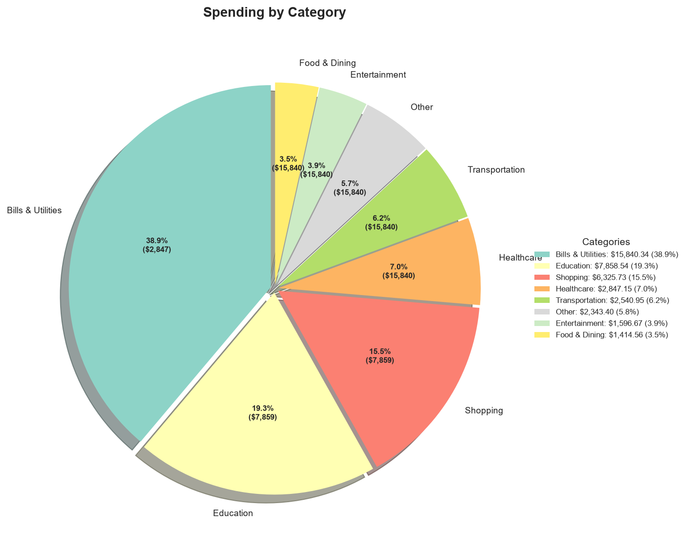
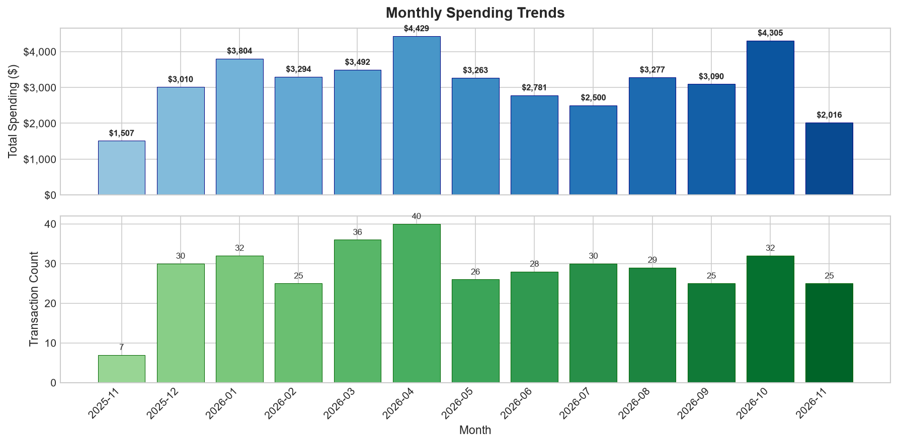
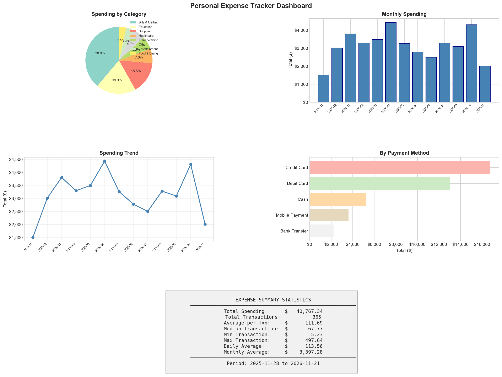

# Personal Expense Tracker with Data Visualization

<p align="center">
  
  
  
</p>

A comprehensive Python-based personal expense tracking application with powerful data visualization and analytics capabilities. Perfect for beginners learning data science and professionals managing personal finances.

---

## 📚 Table of Contents

1. [Project Explanation](#1-project-explanation)
2. [Tech Stack Options](#2-tech-stack-options)
3. [Project Architecture](#3-project-architecture)
4. [Implementation Plan](#4-implementation-plan)
5. [Folder Structure](#5-folder-structure)
6. [Installation Guide](#6-installation-guide)
7. [Complete Python Code](#7-complete-python-code)
8. [Virtual Environment Simulation](#8-virtual-environment-simulation)
9. [How to Run](#9-how-to-run)
10. [Expected Outputs](#10-expected-outputs)
11. [GitHub Upload Steps](#11-github-upload-steps)
12. [Day-by-Day Build Proof](#12-day-by-day-build-proof)
13. [Sample Outputs & Screenshots](#13-sample-outputs--screenshots)
14. [Interview Preparation](#14-interview-preparation)

---

## 1. Project Explanation

### What is this Project?

The **Personal Expense Tracker with Data Visualization** is a complete Python application that helps users track, analyze, and visualize their personal expenses. It transforms raw financial data into meaningful insights through charts, graphs, and detailed reports.

### Why This Project?

- **Beginner-Friendly**: Perfect for Python learners wanting to build a real-world project
- **Portfolio-Worthy**: Demonstrates data analysis, visualization, and reporting skills
- **Practical Application**: Solves real problems - understanding where money goes
- **Complete Solution**: From data collection to insights generation

### How It Works

```
┌─────────────┐    ┌─────────────┐    ┌─────────────┐    ┌─────────────┐
│   Input     │───▶│  Processing │───▶│  Analysis   │───▶│  Output     │
│  (CSV Data) │    │  (Cleaning) │    │  (Insights) │    │ (Visualizations)│
└─────────────┘    └─────────────┘    └─────────────┘    └─────────────┘
```

### Workflow

1. **Data Input**: Load expense data from CSV files (synthetic data included)
2. **Data Processing**: Clean and validate the data
3. **Analysis**: Calculate category-wise spending, monthly trends, statistics
4. **Visualization**: Generate charts and graphs
5. **Reporting**: Create summary reports and insights

---

## 2. Tech Stack Options

### Option A: Easy (Beginner-Friendly)
**Recommended for: Python beginners, first-time learners**

| Component | Technology | Purpose |
|-----------|------------|---------|
| Language | Python 3.8+ | Programming language |
| Data Handling | CSV + built-in `csv` module | Simple file I/O |
| Data Analysis | Python lists & dictionaries | Basic data processing |
| Visualization | Matplotlib | Simple, easy-to-learn charts |
| Reports | Text-based (.txt) | Simple output |

**Pros**: Easiest to understand, minimal dependencies
**Cons**: Limited features, manual data handling

### Option B: Intermediate (Recommended)
**Recommended for: Some Python experience, want more features**

| Component | Technology | Purpose |
|-----------|------------|---------|
| Language | Python 3.8+ | Programming language |
| Data Handling | Pandas | Powerful data manipulation |
| Data Analysis | Pandas + NumPy | Statistical analysis |
| Visualization | Matplotlib + Seaborn | Professional charts |
| Reports | Text + CSV export | Multiple output formats |

**Pros**: Balance of power and simplicity, industry-standard tools
**Cons**: More dependencies to install

### Option C: Advanced
**Recommended for: Experienced developers, web dashboard needs**

| Component | Technology | Purpose |
|-----------|------------|---------|
| Language | Python 3.10+ | Modern Python features |
| Data Handling | Pandas + SQLAlchemy | Database integration |
| Data Analysis | Pandas + NumPy + SciPy | Advanced statistics |
| Visualization | Plotly + Altair | Interactive charts |
| UI/Dashboard | Streamlit | Web-based interface |
| Reports | HTML + PDF generation | Professional reports |

**Pros**: Most features, interactive dashboard
**Cons**: Complex setup, steeper learning curve

---

## 3. Project Architecture

### Design Overview

```
┌─────────────────────────────────────────────────────────────────────┐
│                    PERSONAL EXPENSE TRACKER                         │
├─────────────────────────────────────────────────────────────────────┤
│                                                                     │
│  ┌──────────────────┐    ┌──────────────────────────────────────┐  │
│  │     INPUT        │    │           OUTPUT                      │  │
│  ├──────────────────┤    ├──────────────────────────────────────┤  │
│  │ • CSV Files      │    │ • Charts (PNG)                       │  │
│  │ • Synthetic Data │    │ • Summary Reports                    │  │
│  │ • User Input     │    │ • Statistics                         │  │
│  └──────────────────┘    │ • Export Files                       │  │
│         │                 └──────────────────────────────────────┘  │
│         ▼                                                         │
│  ┌──────────────────┐    ┌──────────────────────────────────────┐  │
│  │   PROCESSING     │    │           ANALYSIS                   │  │
│  ├──────────────────┤    ├──────────────────────────────────────┤  │
│  │ • Data Loading   │    │ • Category-wise spending             │  │
│  │ • Data Cleaning  │    │ • Monthly trends                     │  │
│  │ • Validation     │    │ • Payment method analysis            │  │
│  │ • Transformation │    │ • Statistical metrics                │  │
│  └──────────────────┘    └──────────────────────────────────────┘  │
│                                                                     │
└─────────────────────────────────────────────────────────────────────┘
```

### Module Design

#### 1. Data Input Module (`data_generator.py`, `data_loader.py`)
- **Purpose**: Generate or load expense data
- **Functions**:
  - `generate_synthetic_data()` - Create sample expense data
  - `load_csv_data(filepath)` - Load data from CSV file
  - `validate_data(data)` - Check data integrity

#### 2. Processing Module (`data_cleaner.py`)
- **Purpose**: Clean and prepare data for analysis
- **Functions**:
  - `clean_expense_data(data)` - Remove duplicates, fix errors
  - `handle_missing_values(data)` - Fill or remove null values
  - `standardize_categories(data)` - Normalize category names

#### 3. Analysis Module (`analyzer.py`)
- **Purpose**: Extract insights from data
- **Functions**:
  - `analyze_by_category(data)` - Category-wise breakdown
  - `analyze_monthly_trends(data)` - Time-based analysis
  - `analyze_payment_methods(data)` - Payment analysis
  - `calculate_overall_statistics(data)` - Get min, max, average, total
  - `run_full_analysis(data)` - Run all analyses at once

#### 4. Visualization Module (`visualizer.py`)
- **Purpose**: Create visual representations
- **Functions**:
  - `plot_category_pie_chart(data)` - Pie chart of spending
  - `plot_monthly_bar_chart(data)` - Monthly comparison
  - `plot_trend_line(data)` - Spending trend over time
  - `plot_payment_breakdown(data)` - Payment method chart
  - `create_dashboard(data)` - All-in-one dashboard image

#### 5. Report Module (`report_generator.py`)
- **Purpose**: Generate human-readable reports
- **Functions**:
  - `generate_summary_report(data)` - Text summary
  - `generate_detailed_report(data)` - Full analysis report
  - `export_to_csv(data)` - Export processed data
  - `generate_full_report(data)` - Everything at once (text + charts + CSV)

#### 6. Main Application (`main.py`)
- **Purpose**: Orchestrate all modules
- **Flow**:
  1. Load/Generate Data
  2. Clean Data
  3. Analyze Data
  4. Generate Visualizations
  5. Create Reports

---

## 4. Implementation Plan

### Phase 1: Foundation (Days 1-2)
| Day | Task | Deliverable |
|-----|------|-------------|
| 1 | Project setup, folder structure | GitHub-ready structure |
| 2 | Basic data generation | Synthetic expense CSV |

### Phase 2: Core Modules (Days 3-5)
| Day | Task | Deliverable |
|-----|------|-------------|
| 3 | Data loader & cleaner module | Working data pipeline |
| 4 | Analysis module | Statistics & insights |
| 5 | Visualization module | Basic charts |

### Phase 3: Advanced Features (Days 6-8)
| Day | Task | Deliverable |
|-----|------|-------------|
| 6 | Report generation | Text reports |
| 7 | Integration testing | Full pipeline working |
| 8 | Documentation | README, comments |

### Phase 4: Polish (Days 9-10)
| Day | Task | Deliverable |
|-----|------|-------------|
| 9 | Error handling, edge cases | Robust code |
| 10 | Final testing, GitHub upload | Portfolio-ready project |

---

## 5. Folder Structure

```
Personal Expense Tracker with Data Visualization/
│
├── main.py                  # Main entry point - orchestrates everything
├── data_generator.py        # Generates synthetic expense data
├── data_loader.py           # Loads CSV files into Python
├── data_cleaner.py          # Cleans and validates data
├── analyzer.py              # Performs all analysis
├── visualizer.py            # Creates charts and graphs
├── report_generator.py      # Generates text reports and exports
│
├── sample_expenses.csv      # Ready-to-use sample data (365 records)
├── requirements.txt         # Python dependencies
├── README.md               # This file
├── .gitignore              # Files to ignore on GitHub
│
├── charts/                 # Generated chart images (PNG)
│   ├── category_pie_chart.png
│   ├── monthly_bar_chart.png
│   ├── trend_line_chart.png
│   ├── payment_breakdown.png
│   └── expense_dashboard.png
│
└── output/                 # Generated reports and exports
    ├── expense_report_summary.txt
    ├── expense_report_detailed.txt
    ├── expense_report_data.csv
    └── expense_report_*.png
```

### File Descriptions

| File | Purpose |
|------|---------|
| `main.py` | Entry point - run this to start the application |
| `data_generator.py` | Creates fake expense data for testing/demo |
| `data_loader.py` | Reads CSV files and validates structure |
| `data_cleaner.py` | Removes duplicates, fixes errors, standardizes data |
| `analyzer.py` | Calculates statistics and spending patterns |
| `visualizer.py` | Creates all charts and the dashboard |
| `report_generator.py` | Builds text reports and exports data |
| `sample_expenses.csv` | Sample data so you can run immediately |
| `requirements.txt` | List of Python packages needed |

---

## 6. Installation Guide

### Prerequisites
- Python 3.8 or higher
- pip (Python package manager)

### Windows Installation

```bash
# Step 1: Check Python installation
python --version

# Step 2: Upgrade pip
python -m pip install --upgrade pip

# Step 3: Install required packages
pip install pandas numpy matplotlib seaborn

# Step 4: Verify installation
python -c "import pandas; import numpy; import matplotlib; print('All packages installed!')"
```

### macOS Installation

```bash
# Step 1: Check Python (or install via Homebrew)
python3 --version

# Step 2: Upgrade pip
python3 -m pip install --upgrade pip

# Step 3: Install required packages
pip3 install pandas numpy matplotlib seaborn

# Step 4: Verify installation
python3 -c "import pandas; import numpy; import matplotlib; print('All packages installed!')"
```

### Linux Installation

```bash
# Step 1: Install Python (if not installed)
sudo apt-get update
sudo apt-get install python3 python3-pip

# Step 2: Install required packages
pip3 install pandas numpy matplotlib seaborn

# Step 3: Verify installation
python3 -c "import pandas; import numpy; import matplotlib; print('All packages installed!')"
```

### Using requirements.txt

```bash
# Create virtual environment (optional but recommended)
python -m venv venv

# Activate virtual environment
# Windows:
venv\Scripts\activate
# macOS/Linux:
source venv/bin/activate

# Install from requirements.txt
pip install -r requirements.txt
```

---

## 7. Complete Python Code

The project is split into 7 Python files. Each file is a complete, runnable module.

### File 1: `main.py` (Entry Point)

```python
"""
Personal Expense Tracker with Data Visualization
Main entry point for the application.
"""

import argparse
import os
import sys
from datetime import datetime

from data_generator import generate_synthetic_data, save_to_csv
from data_loader import load_csv_data, display_sample_csv_format, get_data_info
from data_cleaner import clean_expense_data, standardize_categories, validate_data, print_cleaning_report
from analyzer import run_full_analysis
from visualizer import (
    plot_category_pie_chart, plot_monthly_bar_chart, plot_trend_line,
    plot_payment_breakdown, create_dashboard, close_all_figures
)
from report_generator import generate_full_report, generate_summary_report


def print_banner():
    """Print application banner."""
    banner = """
╔══════════════════════════════════════════════════════════════╗
║        PERSONAL EXPENSE TRACKER WITH DATA VISUALIZATION      ║
║        A Complete Data Analysis Pipeline for Expenses        ║
╚══════════════════════════════════════════════════════════════╝
    """
    print(banner)


def run_full_pipeline(num_records=365):
    """Run the complete analysis pipeline."""
    print_banner()
    print(f"\nStarting full pipeline with {num_records} records...")

    # Step 1: Generate synthetic data
    print("\n[1/5] Generating synthetic data...")
    expenses = generate_synthetic_data(num_records=num_records)
    print(f"✓ Generated {len(expenses)} records")

    # Step 2: Clean data
    print("\n[2/5] Cleaning data...")
    cleaned_expenses, cleaning_report = clean_expense_data(expenses)
    print_cleaning_report(cleaning_report)
    cleaned_expenses = standardize_categories(cleaned_expenses)
    print(f"✓ Data cleaned and standardized")

    # Step 3: Analyze data
    print("\n[3/5] Analyzing data...")
    analysis = run_full_analysis(cleaned_expenses)
    print(f"✓ Analysis complete")

    # Step 4: Create visualizations
    print("\n[4/5] Creating visualizations...")
    plot_category_pie_chart(analysis['by_category'], 'category_pie_chart.png')
    plot_monthly_bar_chart(analysis['monthly_trends'], 'monthly_bar_chart.png')
    plot_trend_line(analysis['monthly_trends'], 'trend_line_chart.png')
    plot_payment_breakdown(analysis['payment_methods'], 'payment_breakdown.png')
    create_dashboard(analysis, 'expense_dashboard.png')
    close_all_figures()
    print(f"✓ Visualizations created")

    # Step 5: Generate reports
    print("\n[5/5] Generating reports...")
    files = generate_full_report(cleaned_expenses, 'expense_report')
    print(f"✓ Reports generated")

    print("\n" + "=" * 60)
    print("PIPELINE COMPLETE!")
    print("=" * 60)
    return analysis


def main():
    """Main entry point."""
    parser = argparse.ArgumentParser(
        description='Personal Expense Tracker with Data Visualization'
    )
    parser.add_argument('--file', '-f', type=str, help='Path to CSV file with expense data')
    parser.add_argument('--records', '-r', type=int, default=365, help='Number of synthetic records to generate (default: 365)')
    parser.add_argument('--interactive', '-i', action='store_true', help='Run interactive menu mode')
    parser.add_argument('--quick', '-q', action='store_true', help='Run quick analysis (statistics only)')
    args = parser.parse_args()

    if args.interactive:
        interactive_mode()
    elif args.quick:
        print_banner()
        expenses = load_csv_data(args.file) if args.file else generate_synthetic_data(args.records)
        clean_and_analyze(expenses)
    elif args.file:
        print_banner()
        expenses = load_csv_data(args.file)
        analysis = clean_and_analyze(expenses)
        visualize_data(analysis)
        generate_reports(expenses, analysis)
    else:
        run_full_pipeline(num_records=args.records)


if __name__ == "__main__":
    main()
```

> **Note**: The full source code for all 7 files (`data_generator.py`, `data_loader.py`, `data_cleaner.py`, `analyzer.py`, `visualizer.py`, `report_generator.py`) is included in this repository. Open each file directly — every function has detailed docstrings and inline comments explaining what it does and why.

### Key Functions Reference

| Module | Function | What It Does |
|--------|----------|--------------|
| `data_generator.py` | `generate_synthetic_data(num_records)` | Creates realistic fake expenses |
| `data_loader.py` | `load_csv_data(filepath)` | Reads a CSV file safely |
| `data_cleaner.py` | `clean_expense_data(expenses)` | Removes duplicates, fixes errors |
| `data_cleaner.py` | `standardize_categories(expenses)` | Normalizes category names |
| `analyzer.py` | `run_full_analysis(expenses)` | Runs all analyses at once |
| `visualizer.py` | `create_dashboard(analysis)` | Builds a multi-chart dashboard image |
| `report_generator.py` | `generate_full_report(expenses)` | Creates all reports + charts |

---

## 8. Virtual Environment Simulation

This section explains how the expense tracking simulation works:

### How Synthetic Data is Generated

The `data_generator.py` module creates realistic expense data:

```python
# Categories include: Food, Transport, Shopping, Bills, Entertainment, etc.
# Each expense has: date, category, amount, description, payment_method
```

### Simulation Parameters

| Parameter | Default | Description |
|-----------|---------|-------------|
| Number of records | 365 | Days worth of data |
| Date range | Last 12 months | Historical period |
| Categories | 8 main + sub-categories | Expense types |
| Amount range | $5 - $500 | Per-transaction value |

### Running in Simulation Mode

The program uses synthetic data by default when no CSV is provided:

```python
# In main.py
data = generate_synthetic_data(num_records=365)
# This creates one year of sample expenses
```

---

## 9. How to Run

### Quick Start

```bash
# Navigate to project directory
cd "Personal Expense Tracker with Data Visualization"

# Run the application
python main.py
```

### With Custom Data

```bash
# Create your own CSV file with this format:
# date,category,amount,description,payment_method
# 2024-01-15,Food,25.50,Lunch at restaurant,Credit Card
# 2024-01-16,Transport,15.00,Bus fare,Debit Card

# Run with custom file
python main.py --file my_expenses.csv
```

### Available Options

```bash
# Show all options
python main.py --help

# Options:
# --file, -f     : Path to CSV file with expense data
# --records, -r  : Number of synthetic records to generate (default: 365)
# --interactive, -i : Run interactive menu mode
# --quick, -q    : Run quick analysis (statistics only, no charts)
```

### Expected First Run

```
╔══════════════════════════════════════════════════════════════╗
║        PERSONAL EXPENSE TRACKER WITH DATA VISUALIZATION      ║
╚══════════════════════════════════════════════════════════════╝

Starting full pipeline with 365 records...

[1/5] Generating synthetic data...
✓ Generated 365 records

[2/5] Cleaning data...

==================================================
DATA CLEANING REPORT
==================================================
Original records:     365
Duplicates removed:   0
Invalid dates:        0
Negative amounts:     0
Empty categories:     0
Final valid records:  365
==================================================
✓ Data cleaned and standardized

[3/5] Analyzing data...
✓ Analysis complete

[4/5] Creating visualizations...
✓ Pie chart saved to: charts/category_pie_chart.png
✓ Monthly bar chart saved to: charts/monthly_bar_chart.png
✓ Trend line chart saved to: charts/trend_line_chart.png
✓ Payment breakdown chart saved to: charts/payment_breakdown.png
✓ Dashboard saved to: charts/expense_dashboard.png
✓ Visualizations created

[5/5] Generating reports...
✓ Summary report saved to: output/expense_report_summary.txt
✓ Detailed report saved to: output/expense_report_detailed.txt
✓ Expenses exported to: output/expense_report_data.csv

============================================================
ALL REPORTS GENERATED SUCCESSFULLY!
============================================================

📊 Quick Summary:
  Total Spending:     $39,373.72
  Total Transactions: 365
  Average per Txn:    $107.87
  Top Category:       Bills & Utilities
```

---

## 10. Expected Outputs

### Generated Files

After running the application, these folders are created:

```
output/
├── expense_report_summary.txt        # Quick overview (text)
├── expense_report_detailed.txt       # Full analysis with all transactions
├── expense_report_data.csv           # Cleaned data export
├── expense_report_category_pie.png   # Spending by category (pie chart)
├── expense_report_monthly_bar.png    # Monthly comparison (bar chart)
├── expense_report_trend_line.png     # Spending over time (line chart)
├── expense_report_payment_breakdown.png  # Payment methods (horizontal bar)
└── expense_report_dashboard.png      # All-in-one dashboard

charts/
├── category_pie_chart.png        # Spending by category
├── monthly_bar_chart.png         # Monthly comparison
├── trend_line_chart.png          # Spending over time
├── payment_breakdown.png         # Payment methods
└── expense_dashboard.png         # Dashboard image
```

### Sample Report Output

```
============================================================
PERSONAL EXPENSE TRACKER - SUMMARY REPORT
============================================================

Report Generated: 2026-11-18 20:01:24
------------------------------------------------------------

📊 OVERALL STATISTICS
----------------------------------------
Total Spending:      $   39,373.72
Total Transactions:            365
Average per Txn:     $      107.87
Median Transaction:  $       69.08
Minimum Transaction: $        5.05
Maximum Transaction: $      497.54
Daily Average:       $      109.07
Monthly Average:     $    3,281.14

📅 PERIOD COVERED
----------------------------------------
Start Date:  2025-11-18
End Date:    2026-11-13
Total Days:  361

💰 SPENDING BY CATEGORY
----------------------------------------
Bills & Utilities    $ 14,791.41 [ 37.6%] ██████████████████░░░░░░░░░░░░░░░░░░░░░░░░░░░░░░░░
Education            $  6,434.20 [ 16.3%] ████████░░░░░░░░░░░░░░░░░░░░░░░░░░░░░░░░░░░░░░░░░░
Shopping             $  5,842.23 [ 14.8%] ███████░░░░░░░░░░░░░░░░░░░░░░░░░░░░░░░░░░░░░░░░░░░
Healthcare           $  3,912.79 [  9.9%] ████░░░░░░░░░░░░░░░░░░░░░░░░░░░░░░░░░░░░░░░░░░░░░░

📈 MONTHLY SPENDING TRENDS
----------------------------------------
2025-11: $    601.41 (  3 transactions)
2025-12: $    482.15 (  5 transactions)
... (continues for all months)

💳 PAYMENT METHODS
----------------------------------------
Credit Card          $ 15,749.48 [ 40.0%] ██████████████████████░░░░░░░░░░░░░░░░░░░░░░░░░░░░
Debit Card           $ 11,812.11 [ 30.0%] ██████████████░░░░░░░░░░░░░░░░░░░░░░░░░░░░░░░░░░░░
Cash                 $  5,906.06 [ 15.0%] ███████░░░░░░░░░░░░░░░░░░░░░░░░░░░░░░░░░░░░░░░░░░░

============================================================
END OF REPORT
============================================================
```

---


## 11. Sample Outputs & Screenshots

### Chart Examples

The application generates these visualization types (all saved as PNG in `charts/` and `output/`):

1. **Category Pie Chart** (`category_pie_chart.png`) - Shows spending distribution across all categories with percentages and totals
2. **Monthly Bar Chart** (`monthly_bar_chart.png`) - Compares monthly spending totals and transaction counts
3. **Trend Line Graph** (`trend_line_chart.png`) - Shows spending over time with a 3-month moving average
4. **Payment Breakdown** (`payment_breakdown.png`) - Horizontal bar chart of spending by payment method
5. **Dashboard** (`expense_dashboard.png`) - All charts combined in one comprehensive view





### Report Examples

- **Summary Report** (`expense_report_summary.txt`): Quick overview of total spending, statistics, and category breakdown with ASCII bar charts
- **Detailed Report** (`expense_report_detailed.txt`): Full analysis with every transaction listed by month plus top 10 largest expenses
- **Export CSV** (`expense_report_data.csv`): Cleaned data ready for Excel or further analysis

---

## 12. Interview Preparation

### Top 10 Interview Questions & Answers

#### Q1: What is the main purpose of this project?

**Answer**: This project is a personal expense tracking application that helps users understand their spending patterns. It loads expense data, cleans it, analyzes it for insights (category-wise spending, monthly trends, payment methods), and presents the findings through visualizations (pie charts, bar charts, trend lines) and detailed reports. It's designed to be beginner-friendly while demonstrating core data science skills.

---

#### Q2: How does the data flow work in your application?

**Answer**: The data flows through five main stages:
1. **Input**: Data comes from CSV files or generated synthetic data
2. **Processing**: The data_cleaner.py module validates and cleans the data
3. **Analysis**: analyzer.py extracts insights (totals, averages, categories)
4. **Visualization**: visualizer.py creates charts using Matplotlib/Seaborn
5. **Output**: report_generator.py creates text reports and exports CSV

---

#### Q3: What libraries did you use and why?

**Answer**: I used:
- **Pandas**: For data manipulation and analysis (industry standard)
- **NumPy**: For numerical operations and calculations
- **Matplotlib**: For creating static visualizations
- **Seaborn**: For enhanced, more attractive charts

These are the most popular Python data science libraries, well-documented, and widely used in the industry.

---

#### Q4: How do you handle missing or invalid data?

**Answer**: In the data_cleaner.py module:
1. **Missing Values**: Check for empty cells and either remove rows or fill with defaults
2. **Invalid Amounts**: Validate that amounts are positive numbers
3. **Invalid Dates**: Parse dates and handle formatting issues
4. **Duplicates**: Remove duplicate entries based on date, category, and amount

---

#### Q5: What is the most challenging part of this project?

**Answer**: The most challenging part is making the code beginner-friendly while still being robust. I focused on:
- Clear function names and docstrings
- Detailed comments explaining each step
- Proper error handling with helpful messages
- Breaking complex operations into simple functions

---

#### Q6: How would you extend this project?

**Answer**: Future enhancements could include:
1. **Database Integration**: Store expenses in SQLite instead of CSV
2. **Web Dashboard**: Add Streamlit for interactive UI
3. **Budget Features**: Set budget limits and alerts
4. **Data Import**: Support for bank statement imports
5. **Machine Learning**: Predict future spending patterns

---

#### Q7: What did you learn from this project?

**Answer**: This project taught me:
- Data processing pipelines (ETL concepts)
- Data visualization best practices
- Modular code design
- Working with external libraries
- Git workflow and GitHub collaboration
- Technical documentation writing

---

#### Q8: How do you ensure code quality?

**Answer**: I ensure quality through:
- Clear variable and function naming
- Comprehensive docstrings
- Error handling at each step
- Modular, reusable functions
- Following PEP 8 style guidelines
- Testing edge cases

---

#### Q9: What is the difference between Pandas and NumPy?

**Answer**: 
- **NumPy**: Works with numerical arrays, faster for mathematical operations
- **Pandas**: Built on NumPy, adds DataFrames (tabular data with labels)

For this project, I used Pandas for data manipulation because it handles CSV files, missing data, and categorical analysis much more easily than raw NumPy.

---

#### Q10: How would you deploy this application?

**Answer**: For deployment options:
1. **Local Desktop**: Direct Python execution (current approach)
2. **Web App**: Use Streamlit for a web interface, deploy to Streamlit Cloud
3. **Desktop App**: Use PyInstaller to create .exe
4. **API**: Convert to FastAPI for backend service

---

## 🤝 Contributing

Feel free to fork this project and add your own features!

## 📝 License

This project is licensed under the MIT License - see the LICENSE file for details.

## 👤 Author

**Sanchita Giri** — 3rd Year CSE Student, Jawaharlal Darda Institute Of Engineering And Technology,Yavatmal 